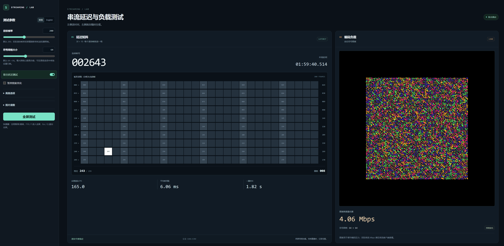

# Streaming Stress

This is a stress test webpage for Moonlight + Sunshine streaming. The page continuously generates changing, high-complexity patterns to test encoder and decoder latency at different frame rates and bitrates. It also simultaneously performs a network stress test to determine the maximum bitrate the current network environment can support for streaming.



## Motivation

The goal of this project is to provide a stable, repeatable, and adjustable
visual load source for streaming tests.

In practice, the bottleneck is often not just “how complex the image looks,”
but the interaction between encoder load, display refresh, VSync, pixel
density, and render area size. Keeping those variables in one page makes it
easier to find a configuration that drives bitrate and frame rate where you
want them.

The page continuously generates changing, high-complexity visuals on the GPU
while keeping CPU usage low.

Rapidly changing timestamps and frame numbers can blur or overlap in phone photos
of the host and stream displays. The latency matrix moves one bright cell per
rendered frame, making the two positions easier to compare while the existing
pattern applies bitrate load.

The pattern is inspired by libcimbar's symbol/tile idea, but it is not a
compatible encoding format. The image is a `width x height` grid of symbols.
Each symbol is an `8 x 8` tile pattern, and each tile is rendered as a square
of N pixels. Each symbol combines `k` color bits with `n` shape bits:

```text
bits per symbol = k + n
data per frame = symbol columns * symbol rows * bits per symbol
theoretical pattern data rate = data per frame * measured render FPS
```

This data rate is a pattern-load indicator, not encoded video bitrate or network
throughput. It becomes zero when pattern changes are paused, while the latency
marker continues changing. The page affects encoding demand through visual
complexity; verify actual bitrate using streaming-side statistics.

## Run

Open [index.html](./index.html) in a modern browser.

For more stable testing, serve the directory with a static server:

```bash
python -m http.server 8000
```

Then open:

```text
http://localhost:8000
```

## Layout

- In normal mode, controls are on the left. The test area defaults to a combined
  layout with the latency matrix on the left and the WebGL load pattern on the right.
- Disable `Latency + load` to return to the standalone load view.
- Fullscreen hides the controls and preserves the selected test layout for photography.
- The page defaults to Chinese.

## Controls

The main panel keeps frame rate and grid size prominent. Other pattern controls
are grouped under Advanced.

- `Target FPS`: target pacing, default `200`.
- `Symbol grid size`: default `64 × 64`; adjusts both columns and rows while linked. Slider range is `16–128`; manual input can exceed it.
- `Latency + load`: enabled by default; show a 30×10 matrix, millisecond timestamp, cumulative frame number, cycle number, and render timing.
- `Pause pattern`: pause the load pattern; the latency marker, timestamp, and measurement counter keep advancing.

## High-Performance Defaults

- `Symbol grid size`: `64 × 64`, with rows and columns linked
- `Color bits k`: `2`, meaning 4 colors
- `Shape bits n`: `4`, meaning 16 shapes
- `Tile pixels`: `1`
- `Target FPS`: `200`
- `Motion`: `10`
- `Respect target FPS`: enabled
- `Latency + load`: enabled

## Advanced Options

Hidden by default under `Advanced`:

- `Link rows/columns`: enabled by default; unlink to set rows independently and make the main grid-size control adjust columns only.
- `Symbol rows`: pattern height in symbols, default `64`.
- `Shape bits n`: `2^n` shape types, selectable as 1, 2, 4, 8, or 16; default `n=4`; affects pattern data rate and encoding load.
- `Color bits k`: `2^k` color types, default `k=2` for 4 colors; `0` means one color.
- `Show HUD`: show status text and theoretical pattern data rate.
- `Respect target FPS`: pace to the chosen target, enabled by default.
- `Tile pixels`: default `1`; `0` auto-calculates from 50% screen height.
- `Motion`: frame-to-frame motion, default `10`.
- `Palette shift`: default `0`; low performance impact.

## Shortcuts

- `Space`: pause or resume pattern changes.
- `F10` or `F`: toggle fullscreen.
- `Esc` or `Q`: exit fullscreen.

## Latency testing

`Latency + load` is enabled by default. A white block moves one cell per rendered
frame through a 30×10 snake grid, with positions numbered `0–299`.

Open the page on the host and stream it through Moonlight. Place the host and
client screens side by side, align the matrices at the same height, and photograph
both in one shot.

Read both positions and use the photo calculator:

```text
frame difference = (host position - client position + 300) % 300
delay ms ≈ frame difference * 1000 / measured source FPS
```

This estimate assumes steady rendering, the host ahead, and a delay shorter than
one cycle. Use the source's measured render FPS at capture time; six frames at
60 FPS is about 100 ms. Full-frame mode uses recorded timestamps from the same
session when available, otherwise it estimates from FPS.

Use a short exposure with HDR and night mode off. If several cells appear bright,
record a range and take more samples. The result is the client's display delay
relative to the host screen, not input-to-display latency.

The last 20,000 frame timestamps can be exported as CSV. Export before resetting
or reloading. See the [latency handoff](./LATENCY_HUD_HANDOFF.md) for details.

## Combining latency and bitrate tests

The right-hand pattern preserves the existing symbol/tile generator; it is not a
standard scannable QR code. Fix the stream resolution, frame rate, codec, and target
bitrate, then adjust symbol dimensions, shape/color bits, and motion while checking
actual streaming bitrate. Compare latency at those observed loads.

Splitting the layout changes the pattern's visible area and scaling. Recalibrate
after switching layouts instead of assuming the same settings produce the same
bitrate. The page does not set or read the encoder's bitrate. [Sunshine's configuration
documentation](https://docs.lizardbyte.dev/projects/sunshine/latest/md_docs_2configuration.html#max_bitrate)
describes the client request and host cap; verify actual traffic on the streaming side.

## Notes

WebGL in the browser is still bounded by `requestAnimationFrame`, monitor
refresh rate, browser compositing, and system VSync.
If you increase the symbol grid size or tile pixel size without reducing shader cost,
the FPS drop is expected.
To keep FPS higher over a larger area, first reduce the symbol grid size,
`Tile pixels`, or `Shape bits n`.
