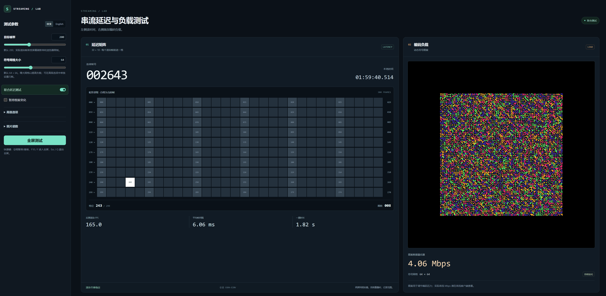

# Streaming Stress

这是一个用于 Moonlight + Sunshine 串流的压力测试网页。页面会在持续生成变化中的高复杂度图案，从而测试在不同帧数、不同码率下的编、解码器延迟。并同时对网络进行压力测试，测试当前网络环境可以支持多高的码率串流。



## 项目动机

这个项目的目的，是提供一个稳定、可重复、可调参的视觉负载源，用来观察
串流在不同码率、帧率、显示比例和画面变化规律下的表现。

实际测试里，瓶颈通常不只是“画面复杂不复杂”，还包括编码器负载、显示刷新、
VSync、像素密度和区域大小之间的组合关系。把这些变量集中在一个页面里，才
方便快速找到一组能把码率和帧率推到目标位置的参数。

页面会在 GPU 上持续生成变化中的高复杂度图案，同时尽量降低 CPU 占用。

延迟测试用来比较主机屏与串流屏的画面时间差。手机拍照时，快速变化的时间戳和帧号容易重叠、模糊，
所以加入了每帧移动一格的方块矩阵，通过亮格位置差辅助读数，也方便在调节码率负载时一起观察延迟。

图案结构借鉴 libcimbar 的 symbol/tile 思路，但不是兼容的编码格式：整张图由
`宽 x 高` 个 symbol 组成，每个 symbol 是 `8 x 8` 个 tile，每个 tile 渲染为
若干像素大小的方块。每个 symbol 由 `k` 位颜色和 `n` 位形状组成，因此：

```text
每 symbol bit 数 = k + n
每帧数据量 = symbol 列数 * symbol 行数 * 每 symbol bit 数
理论图案数据率 = 每帧数据量 * 当前实测渲染 FPS
```

上述数据率是图案负载指标，不是视频编码码率或网络吞吐量。暂停图案变化时，该指标为 0；
延迟矩阵仍会变化，所以串流流量不会因此归零。网页通过改变画面复杂度影响编码负载，
实际码率还取决于 Moonlight/Sunshine 设置和编码器，应以串流端统计为准。

## 运行

直接在现代浏览器中打开 [index.html](./index.html)。

如果你希望更稳定地测试，可以在当前目录启动静态服务器：

```bash
python -m http.server 8000
```

然后访问：

```text
http://localhost:8000
```

## 界面

- 普通模式下，左侧是参数面板；测试区域默认采用联合布局，左侧是延迟矩阵与读数，右侧是 WebGL 压力图案。
- 关闭“联合延迟测试”可回到单独的压力图案视图。
- 全屏模式隐藏参数面板，保留当前测试布局，便于同时拍摄主机屏和串流客户端屏。
- 页面默认使用中文。

## 参数

常用参数只保留帧率与网格大小，其他图案参数收进高级选项。

- `Target FPS`：目标刷新率，默认 `200`。
- `Symbol grid size`（符号网格大小）：默认 `64 × 64`，默认同时调整列数和行数。滑块范围 `16–128`，输入框可设置范围外的值。
- `Latency + load`（联合延迟测试）：默认开启，显示 30×10 延迟矩阵、毫秒时间戳、累计帧号、周数及渲染节奏。
- `Pause pattern`：暂停压力图案变化；延迟矩阵、时间戳和测量帧号继续推进。

## 高性能默认值

- `Symbol grid size`：`64 × 64`，联动行列
- `Color bits k`：`2`，即 4 种颜色
- `Shape bits n`：`4`，即 16 种形状
- `Tile pixels`：`1`
- `Target FPS`：`200`
- `Motion`：`10`
- `Respect target FPS`：开启
- `Latency + load`：开启

## 高级选项

默认隐藏在 `Advanced` 中：

- `Link rows/columns`：默认开启；取消联动后可独立调整行数，主面板网格滑块仅调整列数。
- `Symbol rows`：符号行数，默认 `64`。
- `Shape bits n`：形状数量为 `2^n`，可选 1、2、4、8、16 种，默认 `n=4`；影响图案数据率和编码负载。
- `Color bits k`：颜色数量为 `2^k`，默认 `k=2`，即 4 种颜色；`0` 表示 1 种颜色。
- `Show HUD`：显示状态信息和理论图案数据率。
- `Respect target FPS`：按目标帧率限速，默认开启。
- `Tile pixels`：默认 `1`；`0` 表示按屏幕高度 50% 自动计算。
- `Motion`：变化速度，默认 `10`。
- `Palette shift`：默认 `0`，对性能影响很小。

## 快捷键

- `Space`：暂停或继续图案变化。
- `F10` 或 `F`：切换全屏。
- `Esc` 或 `Q`：退出全屏。

## 延迟测试

默认开启。左侧 30×10 矩阵的白格每个渲染帧沿蛇形路径前进一格，位置为 `0–299`。

1. 在主机打开本页，通过 Moonlight 串流同一画面。
2. 两屏并排、矩阵同高，用一张照片拍下两块屏幕。使用短曝光，关闭 HDR 和夜景模式。
3. 在侧栏“照片读数”中输入两侧格位，以及拍摄时源画面的实测 FPS（不是目标 FPS 或手机帧率）。

```text
帧差 = (主机格位 − 串流格位 + 300) % 300
延迟 ms ≈ 帧差 × 1000 / 实测 FPS
```

格位换算要求主机领先、延迟不足一圈且帧率稳定。例如 60 FPS 下相差 6 格，约为 100 ms。
帧率不稳或跨越整圈时，改用“完整帧号”：同一会话内有记录的两帧直接计算时间差，无记录则按 FPS 估算。

最近 20,000 帧的记录可导出 CSV；重置或刷新前先导出。照片中出现多个亮格时记录范围，并多拍几张。
测得的是串流屏相对主机屏的显示延迟，不是输入到显示的完整延迟；曝光和屏幕扫描也会影响读数。
详细原理见 [延迟测试说明](./LATENCY_HUD_HANDOFF.md)。

## 与码率测试配合

右侧保留原有 symbol/tile 压力图案，它不是标准可扫码二维码。固定串流分辨率、帧率、编码器和目标码率后，
调节符号行列、形状/颜色位数和运动强度，观察串流端实际码率，再比较不同负载下的延迟。
联合布局会改变压力图案的可见面积与缩放，所以切换布局后需要重新校准，不能直接沿用原布局的码率对应关系。

网页不直接设置或读取 Moonlight/Sunshine 的编码码率。[Sunshine 文档](https://docs.lizardbyte.dev/projects/sunshine/latest/md_docs_2configuration.html#max_bitrate)
说明目标码率由客户端请求和主机配置共同约束；实际流量应在串流端核对。

## 说明

浏览器里的 WebGL 最终还是受 `requestAnimationFrame`、显示器刷新率、浏览器合成器和系统 VSync 影响。
如果把 symbol 行列数或 tile 像素大小继续放大，帧率掉下去是正常的。
想在更大面积下尽量保帧，优先降低 symbol 行列数、`Tile pixels` 或 `Shape bits n`。
